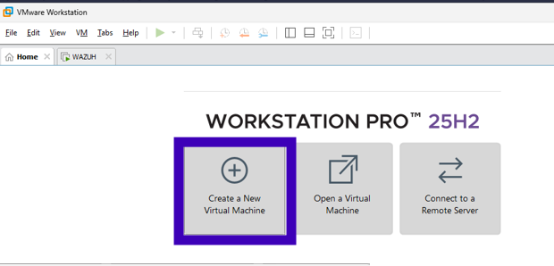
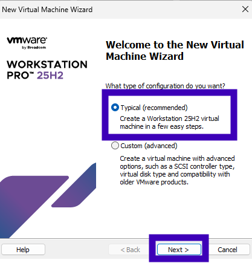
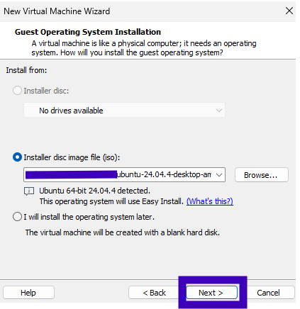
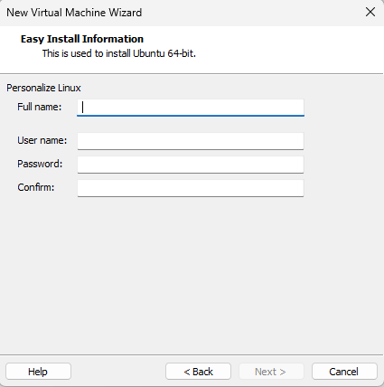
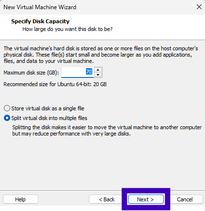
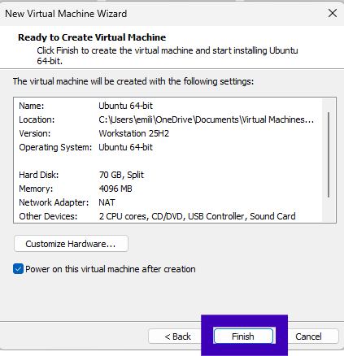
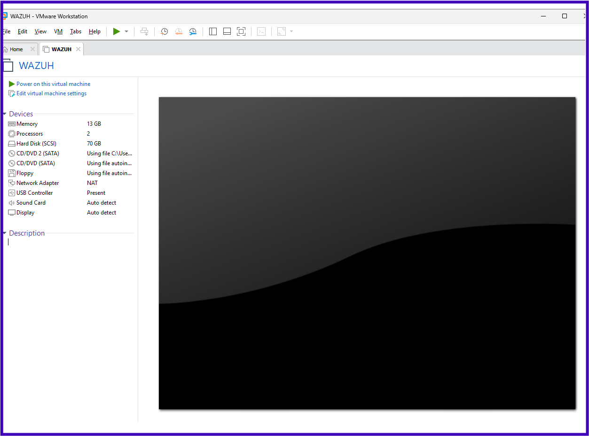
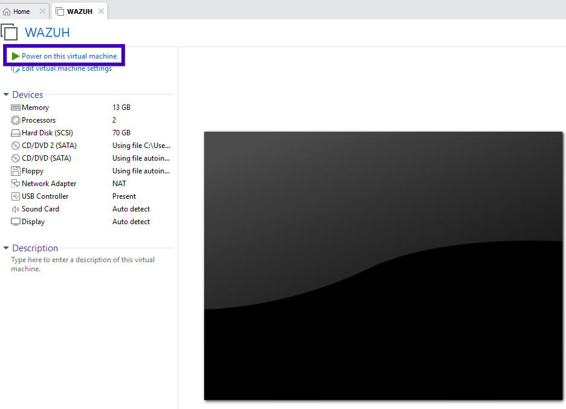
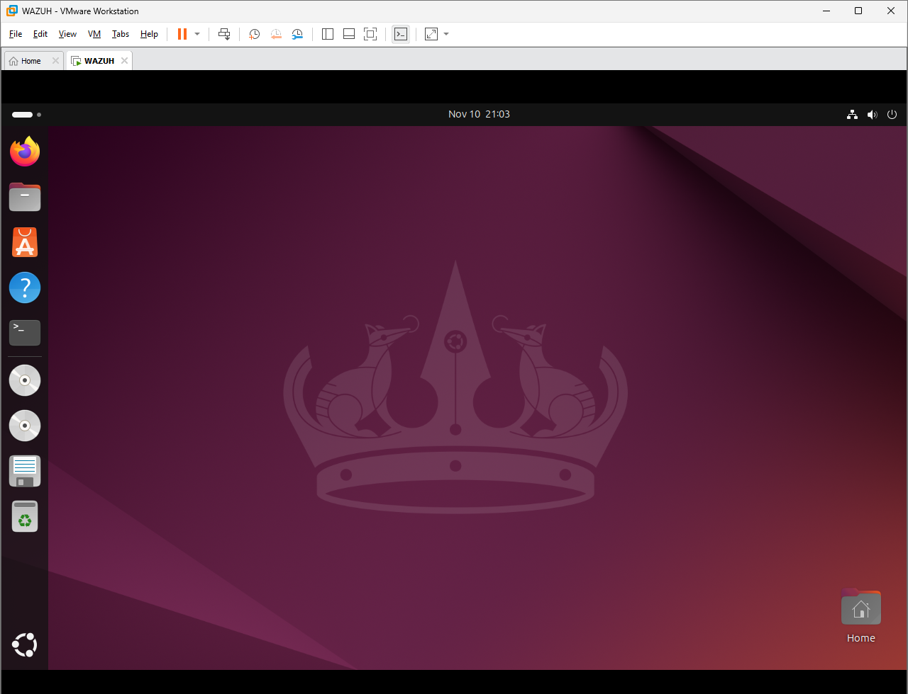

# Setting Up My Ubuntu VM

VMware Workstation Pro 25H2 \| Beginner-friendly setup guide

Since I’m setting up my Wazuh SIEM in a virtual environment, there are a few applications that we can use such as VirtualBox and VMware. For this lab, I’ll be using VMware Workstation Pro.

Just as a heads up: whichever one you choose, make sure it’s compatible with your laptop or PC before installing.

**Where to download:**

- VMware: <https://www.vmware.com/products/desktop-hypervisor/workstation-and-fusion>

- VirtualBox: <https://www.virtualbox.org/>

**Why Ubuntu 24.04 LTS?** Wazuh has listed Ubuntu 24.04 among its recommended operating systems for the central components. In the screenshots for this guide, I’m using Ubuntu Desktop 24.04.4 LTS. Wazuh’s recommendation is for Ubuntu 24.04, it doesn’t say the Server is required. Nonetheless, for additional information check out Wazuh’s documentation before selecting your version: <https://documentation.wazuh.com/current/getting-started/index.html>

## Step 1 – Download Ubuntu and Open VMware

Start by downloading the Ubuntu Desktop ISO from <https://ubuntu.com/download/desktop>

Once the ISO finishes downloading, open VMware Workstation. This step may take a few minutes, so feel free to take a short break while you wait!

Select **“Create a New Virtual Machine”.**

## Step 2 – Choosing the Setup Type

Select **Typical (Recommended)** and then **Next.**

## Step 3 – Select Your Ubuntu ISO

Select **Installer disk image file (iso)** then click **Browse** and locate the ISO file that downloaded. Then click **Next.**

## Step 4 – Fill In Your Ubuntu Account Information

Next, fill in the information prompted under **Easy Install Information.** This information is for your Ubuntu account and not your Wazuh admin login.

## Step 5 – Give The VM Enough Storage

For **Specify Disk Capacity**, I’d recommend beefing up your Ubuntu VM by allocating 70 GB of storage, if your computer has enough available space. Once you start adding Wazuh agents and collecting security logs, that extra storage will come in handy as you continue beefing up your Wazuh SIEM home lab.

## Step 6 – Review Everything and Click Finish

At **Ready to Create Virtual Machine**. Take a quick glance over the settings and make sure everything looks the way you want. Then select **Finish** to create the Ubuntu VM!

Click **Finish**

## Step 7 – Double Check VM Settings

Now you should see your new VM in VMware Workstation. Before powering it on, check the memory, processors, disks, and network settings to make sure they’ll work for this setup.  

## Step 8 – Power On The VM

After everything looks good, then Click on **Power on this virtual machine**

## Step 9 – Ensuring Ubuntu Boots Successfully

Give Ubuntu a moment to load. You should see the Ubuntu Desktop, just like in my screenshot below. If you’re prompted to sign in, use the Ubuntu account that you created during setup.

## Great Job – The Ubuntu VM Is Ready!

You’ve now got Ubuntu running in a virtual environment. Next up, we’ll open Terminal and Install Wazuh’s central components so we can start building out the SOC Home Lab
