# Installing Wazuh SIEM on Ubuntu

Wazuh 4.14 / All-in one installation on my Ubuntu VM

Now that the Ubuntu VM is ready, it’s time to get the Wazuh up and running! I’m using Wazuh 4.14 for this walkthrough. Then install the central components, open the Wazuh dashboard, and secure the Admin account.

> Before continuing, this walkthrough uses the Ubuntu Desktop VM from Guide 01. Wazuh recommends Ubuntu 24.04 for its central components. Ensure that the VM is connected to the internet and check out Wazuh’s current hardware requirements before running the installer.

## Step 1 – Power On Ubuntu and Open Terminal

**Power on** the Ubuntu VM and wait for the desktop to load.

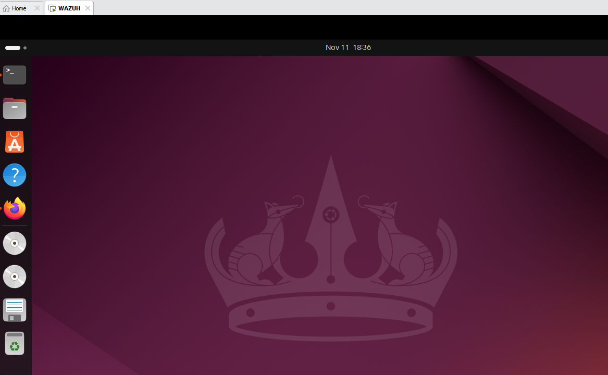

Next, open the terminal. This is where we’ll enter the commands to install Wazuh

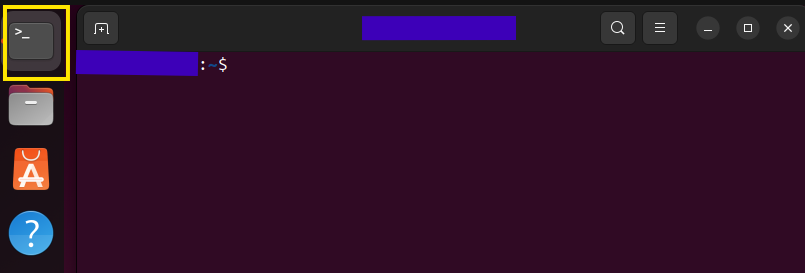

## Step 2 – Update Ubuntu

Start by updating Ubuntu, entering the following command:


```bash
sudo apt update && sudo apt upgrade -y
```


The first part of the command refreshes the list of available packages, and the second part installs available updates. The -y option automatically confirms the upgrade prompt. If Ubuntu requests you to restart, then do that before moving on.

## Step – 3 Download The Wazuh Installer

Next, download the Wazuh 4.14 installation script:


```bash
curl -sO https://packages.wazuh.com/4.14/wazuh-install.sh
```


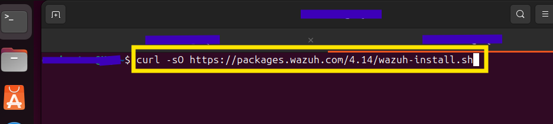

“Curl” downloads the script, and -sO saves it quietly using the original filename. Run this script in the next step.

## Step 4- Install Wazuh

**Now run the all-in-one installer:**


```bash
sudo bash ./wazuh-install.sh -a
```


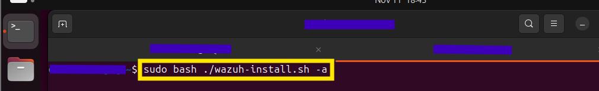

The -a option installs the three central Wazuh components on this Ubuntu VM:

- Wazuh Manager – analyzes security events and applies detection rules

- Wazuh Indexer – stores the security data and makes it searchable

- Wazuh Dashboard – visually view alerts, monitor security activity, and investigate events

## Step 5 – Wait For The Installation To Finish

BE PATIENT! The installation can take a few minutes. Wait until you see the successful installation message, just like in my screenshot below. Don’t close Terminal while the installer is running.

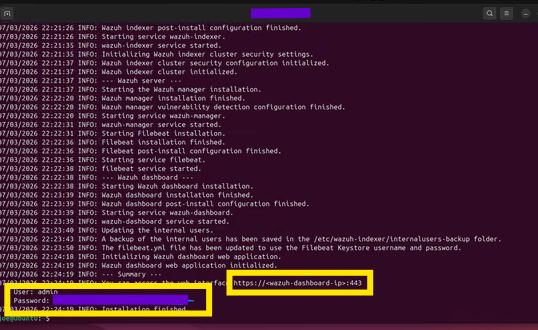

## Step 6 – Find Your Ubuntu VM’s IP Address

To find your Ubuntu VM’s IP address, enter:


```bash
hostname -I
```


This command will show the IP address assigned to your VM. Look for the IPv4 address connected to your active VM network. Your Terminal will display your own IP address after you run this command. 

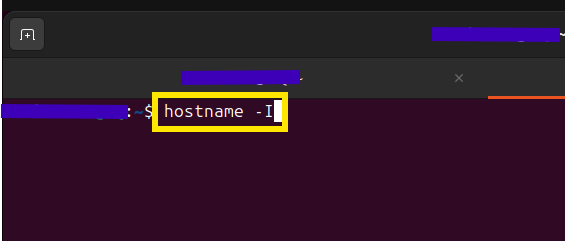

## Step 7 – Open the Wazuh Dashboard in Firefox

Now that you have your Wazuh login credentials and Ubuntu VM’s IP address, open Firefox inside Ubuntu.

In the address bar, enter:

`https://<YOUR-VM-IP>:443`

Replace \<YOUR-VM-IP\> with the IP address you found in the previous step, port 443 is the default HTTPS port for the Wazuh Dashboard.

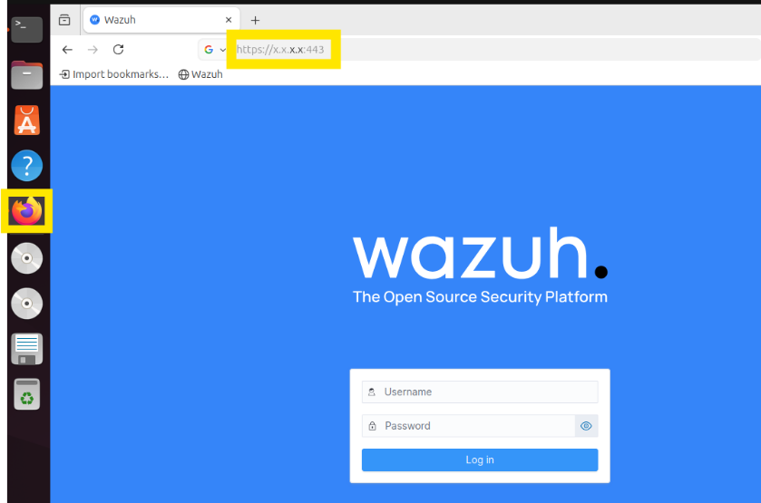

Open the Wazuh dashboard using your VM IP address

## About The Firefox Security Warning

You may see Firefox certificate warning. That can happen in a home lab because the Wazuh dashboard may use a self-signed certificate that Firefox doesn’t automatically trust.

Before clicking anything, double-check that the IP address belongs to YOUR Wazuh VM. Only if you’ve confirmed it’s your own trusted lab, select Advanced and the Accept the Risk and Continue. Never ignore certificate warnings on websites you don’t recognize.

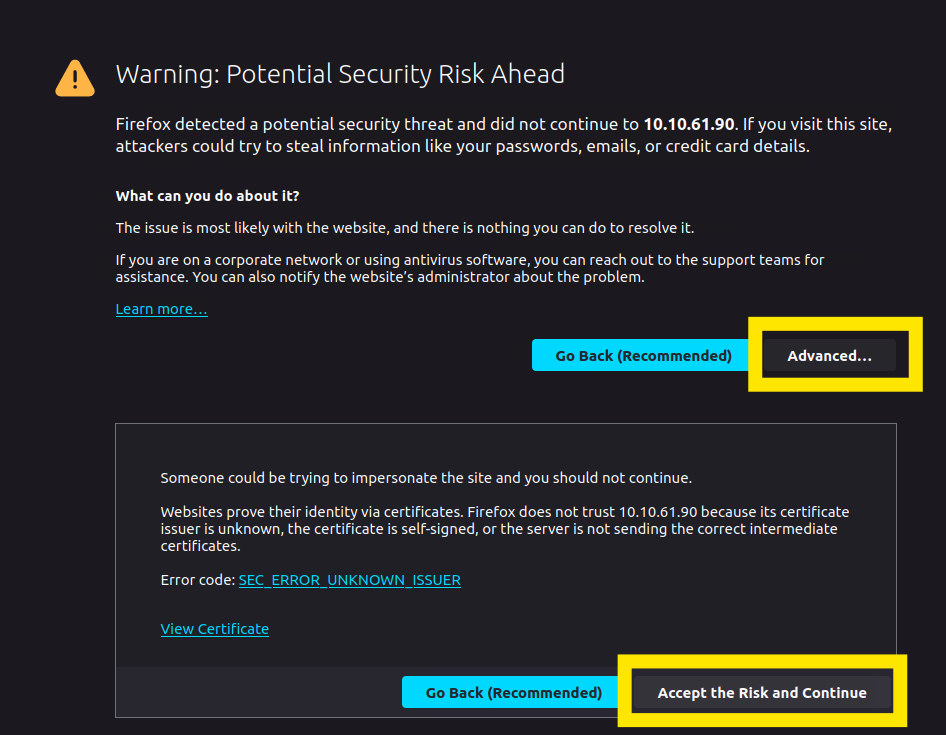

## Step 8 – Log In To Wazuh

You should see the Wazuh login page. Use the admin username and the password generated password during installation to log in.

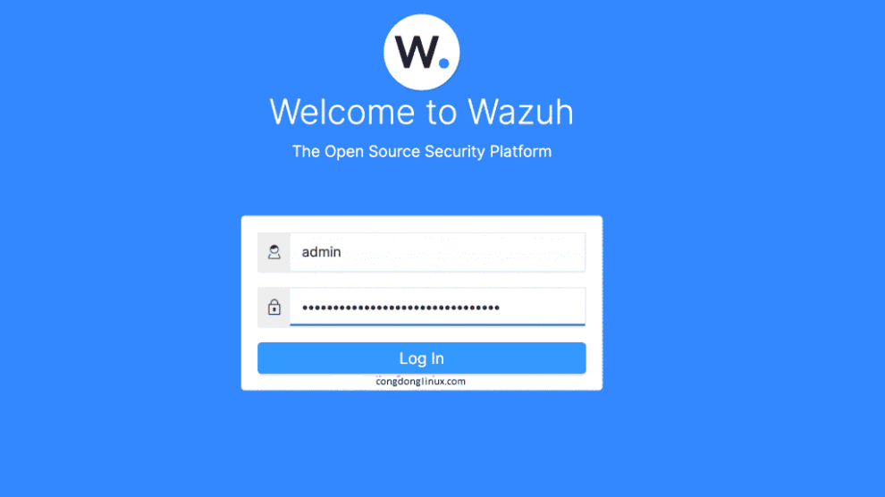

## Step 9 – Make Sure The Dashboard Loads

Now you're into Wazuh!!! You should see the dashboard, just like in my screenshot below.

If you see that there are no agents registered, don’t worry - that’s normal at this stage. We’ve installed the central Wazuh components, but we haven’t connected any Windows or Linux endpoints yet.

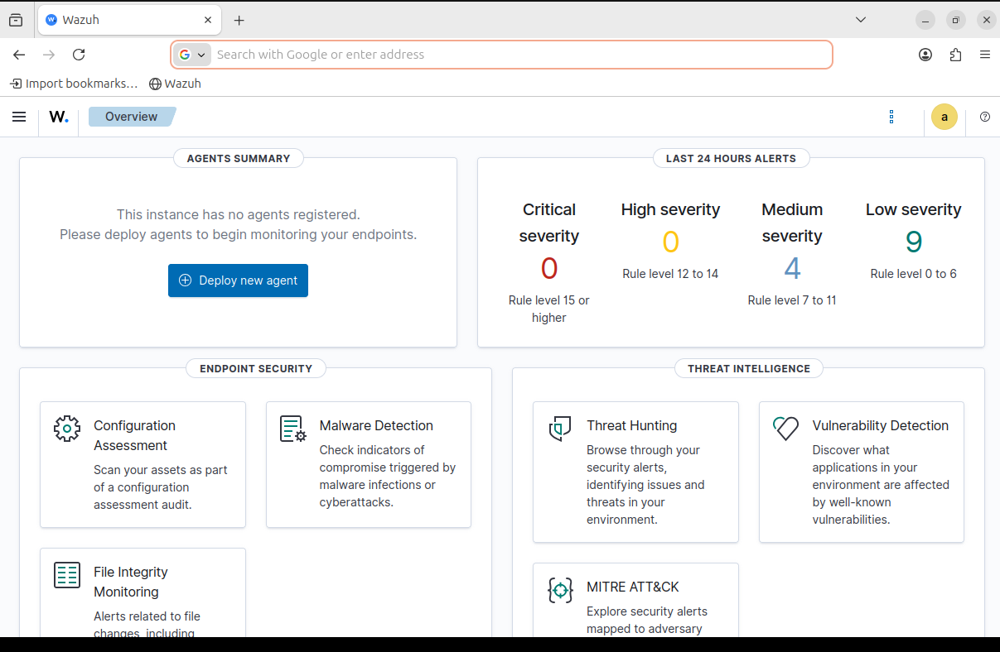

## Step 10 – Change the Generated Admin Password

As always, let’s follow a cybersecurity best practice: CHANGE THAT GENERATED ADMIN PASSWORD!!!

Click the profile icon in the upper-right corner of the dashboard, then select “Reset password.”

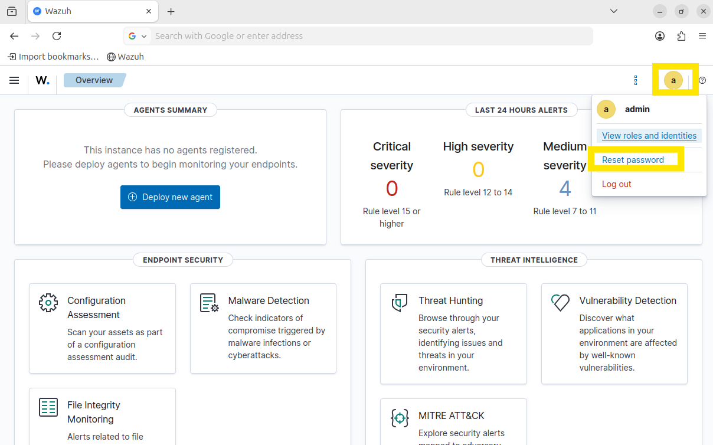

Enter your current password, type your new password, re-enter it to confirm, and click “Reset.” Use a strong, unique password and save it somewhere secure.

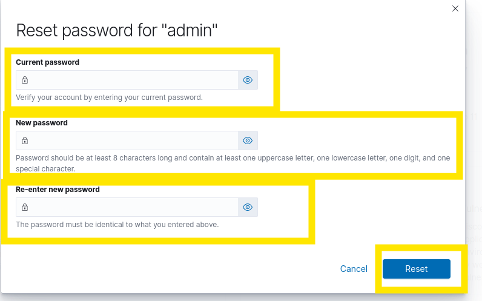

## Great job! Wazuh Is Up and Running

You’ve successfully installed Wazuh SIEM on your Ubuntu VM, accessed the dashboard, and secured your admin account!

Now that Wazuh is up and running, it’s time to take our SOC home lab to the next level! Next up, we’ll deploy our first Wazuh agent to start monitoring an endpoint, collecting security logs, and eventually investigating security alerts.
